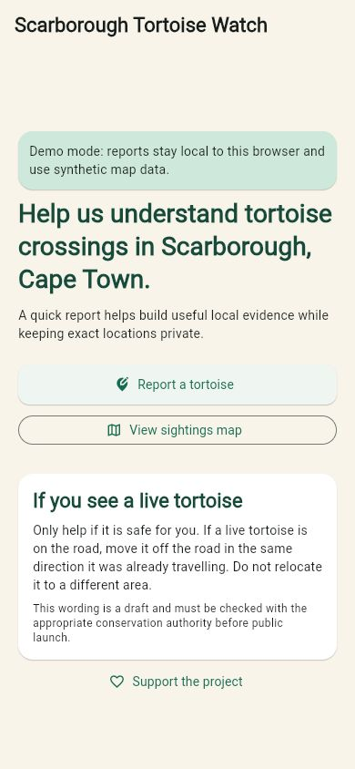

# Scarborough Tortoise Watch

Scarborough Tortoise Watch is a small mobile-first Flutter Web/PWA starter for collecting community tortoise road-sighting evidence in Scarborough, Cape Town. The reporting flow is deliberately quick and does not require visible registration. Exact incident records and photographs are private; the public map uses a separately generated, displaced projection.

The app starts in a labelled demo mode and needs no Firebase credentials. Demo submissions are held in memory and public map markers are synthetic. Firebase is opt-in and fails closed when generated platform options are missing.

## Prerequisites

- Flutter 3.41.1 or newer on the stable channel
- Dart 3.11 or newer
- Node.js 22 for `functions/`
- Java 21 if using Firebase emulators
- Firebase CLI for later emulator/deployment setup

## Run locally

```powershell
& 'C:\Users\admin\Documents\Flutter\flutter\bin\flutter.bat' pub get
& 'C:\Users\admin\Documents\Flutter\flutter\bin\flutter.bat' run -d chrome
```

Demo mode is the default. [Development setup](docs/DEVELOPMENT.md) explains real FlutterFire-generated options, the explicit ignored Firebase entry point, App Check and demo-only emulator connections. `USE_FIREBASE=true` with the default entry point fails closed. No credentials belong in this repository.

## Verify

```powershell
& 'C:\Users\admin\Documents\Flutter\flutter\bin\cache\dart-sdk\bin\dart.exe' format --set-exit-if-changed lib test
& 'C:\Users\admin\Documents\Flutter\flutter\bin\flutter.bat' analyze
& 'C:\Users\admin\Documents\Flutter\flutter\bin\flutter.bat' test
& 'C:\Users\admin\Documents\Flutter\flutter\bin\flutter.bat' build web --release --pwa-strategy=none
npm ci --prefix functions
npm test --prefix functions
firebase emulators:exec --only auth,functions,firestore,storage --project demo-scarborough-tortoise-watch 'node functions/test/emulator-all.cjs'
```

See [verification results](docs/SETUP_VERIFICATION.md) and [test instructions](docs/TESTING.md). Emulator checks use synthetic local data with a `demo-` project; no cloud project is required. No production deploy is part of this foundation.

## Structure

`lib/features` owns report, public map, admin and support flows. `lib/core` contains privacy and service seams. `functions/` owns callable validation, idempotency, moderation and server-side public projection. Rules, indexes and emulator ports are in the repository root. Detailed product, privacy, security, development and operations context lives in `docs/`.

## Map and privacy

The app abstracts the tile provider behind `MapProvider`; the starter uses OpenStreetMap tiles with attribution. Review acceptable use and capacity before production, and do not assume unrestricted public tile-server use. Public clients read only `publicIncidents`, which contains an opaque ID, incident classification, coarse date and displaced coordinates. They never read private `incidents` or Storage objects.

## Screenshots

Verified local demo at 390 × 844:



[Successful synthetic report](docs/screenshots/demo-thanks.jpg) · [Complete directory tree](docs/DIRECTORY_TREE.txt)

## Detailed context

- [Project context](docs/PROJECT_CONTEXT.md), [requirements](docs/PRODUCT_REQUIREMENTS.md), [MVP scope](docs/MVP_SCOPE.md) and [roadmap](docs/ROADMAP.md)
- [Architecture](docs/ARCHITECTURE.md), [data model](docs/DATA_MODEL.md) and [decisions](docs/DECISIONS.md)
- [Privacy](docs/PRIVACY.md), [security](docs/SECURITY.md), [conservation guidance](docs/CONSERVATION_GUIDANCE.md) and [donations](docs/DONATIONS.md)
- [Development](docs/DEVELOPMENT.md), [testing](docs/TESTING.md), [deployment](docs/DEPLOYMENT.md), [operations/cost monitoring](docs/OPERATIONS.md) and [agent instructions](AGENTS.md)
